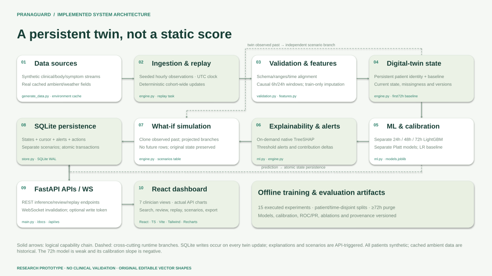
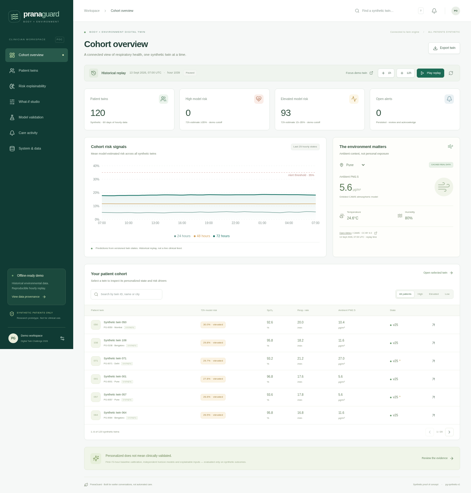

# PranaGuard
## Project title
**PranaGuard — Body × Environment Digital Twin for COPD Exacerbation Forecasting**

> **One-line pitch:** A persistent, personalized synthetic COPD twin that connects body signals with ambient exposure, estimates three future risk horizons, and makes its assumptions inspectable.

**Submission status: NOT FULLY SUBMISSION-READY.** The application and local artifacts are functional and tested. Public GitHub publication, actual Unlisted YouTube upload, team/institution details, and unauthenticated public-access verification remain outstanding. The model is NOT clinically validated and the 72h experiment is a negative result.

## Team details
| Field | Value |
|---|---|
| Team name | [PENDING — TEAM NAME] |
| Members / roles | [PENDING — MEMBER NAMES, ROLES AND CONTACT] |
| Clinical advisor | [PENDING — optional advisor, do not imply clinical endorsement] |
| Challenge | Happiest Health Digital Twin Challenge 2026 |

## College/incubator information
[PENDING — COLLEGE / INCUBATOR]

The owner must replace placeholders before submission. [submission_metadata.json](submission_metadata.json) is the machine-readable source for these fields. No names, institutions or affiliations have been invented.

## Project overview
This working research prototype maintains 120 synthetic patient twins over 60 days. It joins synthetic clinical/physiological streams to real, cached city-level ambient model data, calibrates personal baselines, predicts separate 24/48/72h risks, persists hourly state versions, computes real explanations and runs conditional scenario branches without mutating the source twin.

The missing idea DOCX was not available. The user explicitly authorized the supplied master message as the implementation specification; see [source specification](docs/SOURCE_SPECIFICATION.md).

## Problem statement
COPD exacerbations can lead to emergency care, hospitalization and health deterioration. An actionable warning system would need to combine changing physiology and symptoms with patient history and exposure, not merely display an isolated reading. PranaGuard explores that engineering workflow. This prototype does **not** establish that the trained models provide clinically useful warning.

## Healthcare use case
A clinician reviews a synthetic outpatient COPD cohort, opens a patient-specific twin, compares baseline/current measurements, inspects model-estimated risk and drivers, reviews alerts, documents a review and explores environmental/adherence/activity assumptions. Four Indian demonstration locations are used: Pune, Mumbai, Delhi and Bengaluru. No clinical deployment, real participants, hospital partnership, device integration or demonstrated health benefit is claimed.

## Technical stack
| Layer | Implemented technology |
|---|---|
| Frontend | React, TypeScript, Vite, Tailwind CSS, Recharts, Lucide React |
| Backend | Python 3.13, FastAPI, Uvicorn, Pydantic, REST + WebSockets |
| ML | pandas, NumPy, scikit-learn Logistic Regression, LightGBM, joblib |
| Explainability | Exact native LightGBM TreeSHAP; documented reference-perturbation fallback for non-tree models; SHAP package available |
| Database | SQLite, WAL, foreign keys, transactional replay writes |
| Tests | pytest, Vitest, React Testing Library, Playwright Chromium integration |
| Documents | Editable python-pptx output, actual LibreOffice PDF exports, original vector diagrams |

No Streamlit, containers or orchestration tooling is required or used.

## Digital-twin architecture and features
- Stable patient ID, synthetic clinical profile, first-72-hour baseline, current measurements, model features, risks, warnings and provenance.
- Immutable, queryable SQLite state versions with deterministic hourly updates for the full cohort.
- Separate fitted and calibrated 24-, 48- and 72-hour models, not one score copied across horizons.
- Real native TreeSHAP drivers, patient-relative deviations, risk deltas and feature-contribution deltas between versions.
- Persisted model alerts, acknowledgement/resolution, append-only clinician action logs and separate scenario records.
- What-if branches use only observed past plus explicitly projected assumptions; the original twin is preserved.
- Offline historical replay and source freshness/missingness reporting. **Not a live patient feed.**

This is a **stateful data-driven research twin**, not a validated mechanistic lung model or treatment controller. [Architecture implementation notes](docs/ARCHITECTURE.md) · [API reference](docs/API.md) · [Detailed methodology](docs/METHODOLOGY.md) · [Limitations](docs/LIMITATIONS.md).

## Architecture diagram in PDF/PPT format
- [Architecture PDF](docs/architecture/PranaGuard_Architecture.pdf)
- [Editable architecture PPTX](docs/architecture/PranaGuard_Architecture.pptx)
- [Architecture SVG](docs/architecture/PranaGuard_Architecture.svg)



These are separate deliverables, not only an image embedded in the presentation.

## Data sources and real-versus-synthetic provenance
The cohort contains **120 synthetic patients, 60 days, 172,800 hourly rows and 263 stochastic synthetic event onsets**. Clinical profiles, wearable-style values, symptoms, adherence and outcomes are all synthetic. They do not correspond to real people. The generator is reproducible with seed 2026 and is not a validated physiological disease model.

Ambient PM2.5, PM10, NO2, ozone, temperature and humidity are joined from eight real cached API responses, spanning 2026-08-01 to 2026-09-29 UTC for four cities. These are Open-Meteo/CAMS and historical weather model products, **not personal exposure or live conditions**. No future environmental observations are fed to the forecast or scenario branch.

[Data provenance and verified source URLs](docs/DATA_PROVENANCE.md) · [Exact API URLs, access times and checksums](data/environment/manifest.json) · [Generation manifest](data/generation_manifest.json).

Primary source URLs: https://open-meteo.com/en/docs/air-quality-api and https://open-meteo.com/en/docs/historical-weather-api . Cached data are redistributed with attribution under CC BY 4.0. The free hosted API is for non-commercial fair use; commercial access terms differ. See [third-party licenses](docs/THIRD_PARTY_LICENSES.md).

The bundled cache supports offline generation. Without a valid cache, generation fails unless `--allow-synthetic-environment` is explicitly supplied, in which case the source is visibly labelled synthetic; no generated fallback is described as real.

## AI/ML model or framework details
### Models and label definition
Logistic Regression is the baseline. LightGBM is the deployed primary model, with one binary classifier per horizon. Each model has a separate Platt logistic calibrator fitted to a disjoint calibration partition. Models are persisted with joblib. Native LightGBM TreeSHAP explains the raw tree score.

For an eligible patient-hour t, `y_h = 1` if a **new synthetic event onset** occurs in `(t, t+h]`; otherwise 0. First-72h baseline rows, hours during a synthetic active episode/onset, and the final 72h without complete follow-up are excluded from fitting/evaluation. Labels are generated stochastic onsets, not adjudicated COPD exacerbations.

### ML methodology and leakage prevention
- **Patient-disjoint + calendar-time-disjoint partitions:** 72 train patients, 24 calibration patients, 24 test patients. IDs, location labels, timestamps, event flags and future labels are not features.
- A ≥72h purge separates feature windows between partitions so future label intervals do not cross boundaries.
- Personal baselines use only the first72h, before any fitted/evaluated state. They are a permitted warm-up for unseen patients, not future full-course averages.
- Trailing 6h/24h windows and past differences are causal. No centered windows, backward fill, future symptoms, future exposure or future events are inputs.
- Median imputation and LR scaling fit on train only. Calibration uses calibration patients/time only. Test is not used to select hyperparameters or thresholds.
- Fixed choices: LightGBM 160 trees, learning rate .045, max depth5, 15 leaves, train stride3, seed2026, demonstration alert cutoff .35. No hyperparameter search.
- Actual fitted rows: **14605 train**, **1377 calibration**; **4699 hourly test windows**. Exact IDs, timestamps and bounds are in [split_manifest.json](artifacts/split_manifest.json).

### Actual results from executed experiments
| Model | Horizon | AUROC | AUPRC | Brier |
|---|---:|---:|---:|---:|
| LightGBM | 24h | 0.6916 | 0.0882 | 0.0279 |
| LightGBM | 48h | 0.6144 | 0.0968 | 0.0557 |
| LightGBM | 72h | 0.3951 | 0.0593 | 0.0853 |
| LogisticRegression | 24h | 0.6619 | 0.1993 | 0.0260 |
| LogisticRegression | 48h | 0.6285 | 0.1841 | 0.0537 |
| LogisticRegression | 72h | 0.6253 | 0.2281 | 0.0800 |

The full [15-experiment evaluation](artifacts/evaluation.md), [machine-readable curves/metrics](artifacts/evaluation.json), [ablation CSV](artifacts/metrics.csv), [saved test predictions](artifacts/test_predictions.csv.gz), and [independent metric recomputation](artifacts/evaluation_verification.json) are included.

**Negative findings must not be hidden:** at 72h, LightGBM AUROC is 0.3951 and AUPRC 0.0593, below the 0.0773 prevalence baseline for AUPRC. LR performs better at 72h (AUROC 0.6253, AUPRC 0.2281). There is no consistent ablation improvement. The fitted 72h Platt slope is negative, reversing raw tree-score direction. All three primary horizon models have zero sensitivity at the fixed .35 cutoff on this test set. The 72h alert audit detects **0 of 5** held-out synthetic onsets; no median lead time can be established. No improvement, clinical lead time or patient benefit is claimed.

150 patient-cluster bootstrap resamples give descriptive uncertainty intervals (in JSON); hourly windows are correlated, and only five test-window onsets make performance unstable. Shared environmental fields add cross-patient dependence. This evaluates generator learnability and a software workflow, **not clinical validity**. The first and second reproducibility runs are compared in [the reproducibility audit](docs/verification/reproducibility.json).

## Explainability and scenario methodology
TreeSHAP contributions sum with the base value to the uncalibrated tree log-odds. They do not sum to the final calibrated probability. The negative 72h calibration slope is explicitly disclosed in the UI; positive raw-score contributions can correspond to lower calibrated risk. Explanations are associations, not causal effects.

Scenario assumptions support PM2.5 −80 to +100% (6h exponential transition, PM10 proportional), adherence 0–1, activity 0.5–1.5× current steps. Baseline/scenario branches keep observed physiology constant, recompute causal features over 72 projected hours and call the actual horizon models at each projected time. Scenario results and assumptions persist separately. They are conditional sensitivity paths, **not validated disease evolution, treatment effects or advice**; lower exposure can counterintuitively increase the estimated risk. A horizon estimate evaluated at projected +72h extends beyond the original current-time horizon. No causal benefit is implied by a lower model score.

## Presentation in PDF/PPT format covering project details and outcomes
- [Editable 16-slide PowerPoint](docs/presentation/PranaGuard_Digital_Twin_Challenge_2026.pptx)
- [Actual PDF export](docs/presentation/PranaGuard_Digital_Twin_Challenge_2026.pdf)
- [Technical report (Markdown)](docs/TECHNICAL_REPORT.md)
- [Technical report (PDF)](docs/PranaGuard_Technical_Report.pdf)

The deck uses actual application screenshots and executed experiment results, including negative findings. [Artifact verification](docs/verification/artifact-verification.json) checks OOXML readability, PDF page counts, extracted text, image loading and page/shape bounds; rendered pages were visually reviewed. This verification does not prove public access.

## Actual 15–20 minute demo video link — YouTube Unlisted
**PENDING — record and upload the actual 15–20 minute demo as Unlisted on YouTube. No video has been uploaded.**

A local script, narration, storyboard or generated slide deck is **not** a completed video requirement. The final actual Unlisted YouTube URL must be inserted here and into `submission_metadata.json`, then tested signed out without permissions. Aim for a full 20-minute recording; confirm the latest official duration wording before recording.

- [Timed 20-minute narration and screen-by-screen script](docs/demo/DEMO_SCRIPT.md)
- [Reproducible recording scenario](docs/demo/RECORDING_GUIDE.md)
- [Recording/upload checklist](docs/demo/UPLOAD_CHECKLIST.md)
- [Video status / final URL field](docs/demo/VIDEO_STATUS.md)

## Repository structure
```text
backend/app/                 FastAPI, features, fitted-model inference, validation, twin engine, SQLite
backend/tests/               Backend/scientific-integrity/persistence tests
frontend/src/                React views, API client, charts and UI tests
frontend/package-lock.json   Exact frontend dependency resolution
scripts/                     Fetch, generate, train, evaluate, replay, docs and verification
artifacts/                   Real trained bundle, 15 experiments, test predictions, split/demo metadata
data/environment/            Eight raw public caches + provenance/checksums
data/                        Synthetic compressed longitudinal data and patient profiles
docs/architecture/           Separate PDF, PPTX, SVG
docs/presentation/           Editable 16-slide deck + actual PDF export
docs/screenshots/            Eight images from the actual running app
docs/demo/                   Recording package; actual uploaded video still pending
docs/verification/           Executed test, reproducibility, export and submission audits
submission_metadata.json     Explicit human-owned fields / actual public URLs
```

## Prerequisites and exact installation commands
Tested on Linux with **Python 3.13**, Node.js 20.20.2 and npm 10.8.2. Use Python3.13 for the exact pinned scientific dependency versions. A compiler is normally unnecessary with supported wheels; LightGBM may require the platform's OpenMP runtime (Linux `libgomp1`; macOS `brew install libomp`). Python dependencies are pinned; frontend dependencies are locked. No database server is required. The full tested build environment (including optional document/browser tooling) is recorded in [requirements-lock.txt](requirements-lock.txt); use that lock for strict environment replication.

After downloading/unzipping this repository, enter its root:
```bash
cd PranaGuard-COPD-Digital-Twin
python3.13 -m venv .venv
source .venv/bin/activate
# Windows PowerShell: .venv\Scripts\Activate.ps1
python -m pip install -r requirements.txt
cp .env.example .env
npm --prefix frontend ci
python -m scripts.bootstrap --reset
```
`bootstrap --reset` initializes SQLite and primes 24h of persisted versions using bundled data/models. It intentionally destroys prior demo actions/scenarios; omit `--reset` to retain a run. Normal startup also initializes a missing DB. Do not regenerate model/data bundles while a server is using them; stop it first.

## Backend and frontend startup commands
Terminal A (repository root, virtual environment activated):
```bash
python -m uvicorn backend.app.main:app --host 0.0.0.0 --port 8000
```
Terminal B (repository root):
```bash
npm --prefix frontend run dev -- --host 0.0.0.0 --port 5173
```
Open `http://127.0.0.1:5173`. The browser uses relative `/api` requests; Vite proxies HTTP/WebSockets to FastAPI. Both servers allow the hosted preview. Use **one Uvicorn worker**; distributed replay coordination is not implemented. `npm --prefix frontend run build` creates a production frontend bundle, but a production reverse proxy must serve `/api` and `/docs`; bare `vite preview` is not a complete deployed backend integration.

## API documentation URL
- Interactive: `http://127.0.0.1:8000/docs` or `http://127.0.0.1:5173/docs`
- OpenAPI JSON: `http://127.0.0.1:8000/openapi.json`
- [Route/body reference](docs/API.md)

These localhost addresses are setup instructions, not public submission links.

## Data generation, training, evaluation and ablation commands
Bundled inputs/models already support a demonstration. To reproduce from the bundled environmental cache:
```bash
source .venv/bin/activate
python -m scripts.generate_data --seed 2026 --patients 120 --days 60
python -m scripts.train                  # baseline + 4 input groups × 3 horizons
python -m scripts.select_demo            # truthful retrospective score-selected example
python -m scripts.evaluate               # independently recompute main metrics from saved predictions
python -m scripts.bootstrap --reset
```
Optional **network refresh**, not needed for offline use:
```bash
python -m scripts.fetch_environment --start 2026-08-01 --end 2026-09-29
```
API historical availability/rate limits may change; keep the versioned cache for reproducibility. Do not silently change dates. `python -m scripts.verify_reproducibility` executes generation/training/evaluation again and compares dataset bytes and all main predictions/metrics. `scripts.train` implements all ablations; there is no separate unexecuted ablation promise.

## Regenerate documents and submission audits
Application runtime does not require document tooling. For document rebuilding, install `requirements-docs.txt` and LibreOffice (`sudo apt-get install libreoffice-impress` on Debian/Ubuntu; use the official installer on other systems). Actual screenshots must already exist, or regenerate them through the running app with `scripts.browser_verify`.
```bash
python -m pip install -r requirements-docs.txt
python -m scripts.write_documentation
python -m scripts.build_artifacts       # editable PPTX + actual LibreOffice PDF exports
python -m scripts.verify_artifacts      # parse, render, text/page/bounds/image checks
python -m scripts.verify_submission     # honest local PASS/FAIL/PENDING gate
# Only after actual URLs are available:
python -m scripts.verify_submission --check-public
```

## Backend tests, frontend tests and browser integration
```bash
python -m pytest --junitxml=docs/verification/backend-junit.xml
npm --prefix frontend test -- --reporter=verbose
npm --prefix frontend run build
# Optional browser checks / regenerate screenshots, while both servers run:
python -m pip install -r requirements-docs.txt
python -m playwright install chromium
# Linux only, if required: python -m playwright install-deps chromium
python -m scripts.browser_verify
```
[Clean-install verification](docs/verification/clean-setup.json) independently cloned the local repository, created a new virtual environment, installed pinned Python dependencies, ran npm ci, initialized the bundled demo, started FastAPI through its real lifespan, reran both test suites and built the frontend. A [GitHub Actions workflow](.github/workflows/ci.yml) is prepared but has not been run on GitHub because the repository has not been published.

Last verified: **41 backend tests passed**, **14 frontend tests passed**, **18 actual Chromium integration checks passed**; production frontend build passed. Backend has one upstream Starlette/httpx deprecation warning; no failing tests. The production build uses a separate chart-vendor chunk; dependency audit results are included for the tested build. [Actual backend output](docs/verification/backend-tests.txt) · [frontend output](docs/verification/frontend-tests.txt) · [browser report](docs/verification/browser-verification.json).

The browser run checked actual API-fed charts, search, versions, export, horizon switch, scenario persistence/isolation, timed replay, alerts/actions, reload persistence, source status, no external runtime HTTP requests, no page errors and 390px mobile layout. Unit UI tests use explicitly saved real API fixtures only inside test files; production has no fixture import. No synthetic result is substituted on API failure.

## Offline demonstration, reset and replay
After dependencies are installed, disconnect external internet; keep the local frontend/backend running. All inference and replay use cached local files. First-time dependency installation and optional cache refresh still require internet.
```bash
python -m scripts.replay reset
python -m scripts.replay status
python -m scripts.replay step --hours 12
python -m scripts.replay start
python -m scripts.replay pause
```
The same controls work in the UI. Reset starts at replay hour1039 with 24 prior hourly states. Focus **PG-0071**, then advance **+12h** to hour1051. The actual calibrated 72h score is approximately **35.51%**, causing a persisted alert. This was retrospectively score-selected across the synthetic cohort, is **not** a held-out prospective success, and its synthetic 72h label is **0 (false positive)**. Acknowledge/resolve it, log a review, compare a scenario and reload to verify persistence. Never narrate this example as successful early detection.

## Screenshots from the actual running application


[Patient twin](docs/screenshots/02_patient_twin.png) · [Explainability](docs/screenshots/03_explainability.png) · [What-if studio](docs/screenshots/04_what_if.png) · [Validation](docs/screenshots/05_model_validation.png) · [Alerts/actions](docs/screenshots/06_alerts_and_interventions.png) · [System status](docs/screenshots/07_system_status.png) · [Mobile](docs/screenshots/08_mobile_patient.png).

## Privacy, security, limitations and clinical safety disclaimer
**Research demonstration only. Not a medical device. No clinical validation. Not for diagnosis, triage, prescribing, treatment or emergency decisions.** All displayed patient records are visibly synthetic. No actual treatment efficacy, hospitalization reduction, clinical lead time or patient benefit has been demonstrated.

Default authentication is disabled for local synthetic review. An optional shared demo admin token protects writes only; read-only data and the WebSocket remain public. There is no production RBAC, clinical consent workflow, certified device ingestion, encryption-at-rest guarantee, regulated audit retention or multi-worker coordination. Do not expose real patient data. Use TLS, proper identity/access management, rate limiting, secure storage and clinical governance before any real deployment. Do not load untrusted joblib/pickle bundles.

The generator is simplistic; only five test-window event onsets are available. Nonstationary environment, shared city-level fields, correlated hourly labels, no prospective as-issued feed, possible source revision, weak 72h discrimination, negative calibration slope and zero sensitivity at the chosen threshold prevent clinical claims. Scenario paths hold physiology constant and are not a validated response model. Historical measurements may have gaps; missing inputs are visibly flagged and imputed from train medians. Active-episode/out-of-follow-up states are marked outside the evaluated forecasting regime.

## Future development roadmap
1. Improve generator documentation and evaluate model/calibration stability on **new**, pre-registered synthetic cohorts; do not tune against this fixed test set.
2. Obtain ethical approval, consent and appropriately licensed real longitudinal COPD outcomes with clinician-adjudicated labels.
3. Validate prospectively across patients, time and sites; assess calibration, subgroup fairness, uncertainty, missingness and useful lead time.
4. Add authenticated device/EHR ingestion, personal exposure estimation and recorded as-issued environmental feeds.
5. Establish a defensible causal or mechanistic response model before discussing intervention effects; add clinician safety governance and production controls.

## Open-source license details
Project code, original documents and model bundle: **MIT**, [actual LICENSE](LICENSE). Synthetic patient fields: CC0 1.0. Combined data/cached real environmental fields retain **CC BY 4.0** attribution. Third-party dependencies/assets are separately documented in [THIRD_PARTY_LICENSES.md](docs/THIRD_PARTY_LICENSES.md). No restricted clinical dataset or external commercial image/font is included.

## Dataset attributions and licenses
Environmental data by [Open-Meteo](https://open-meteo.com/) using CAMS global atmospheric composition and historical weather products. Retain provider attribution; modifications are joining, renaming and aligning timestamps, not measurement of personal exposure. Exact provenance: [cache manifest](data/environment/manifest.json). This project does not copy Open-Meteo server code or imply provider endorsement.

## Public GitHub repository and publishing commands
**PENDING — no public GitHub URL has been created or verified.**

The local repository is prepared with the requested name. See [exact authorized publishing commands](docs/PUBLISHING.md). No GitHub credentials or authorized publishing connector were available. No URL has been invented. A workspace/live preview is not evidence that the repository or submission links are public.

## Confirmation that referenced files and links are publicly accessible without additional permissions
**PENDING — NOT CONFIRMED.** Local relative file links, OOXML/PDF artifacts, screenshots and implementation were checked. External source pages and raw data requests were accessible without authentication during the build. The project repository and actual video do not yet have verified public URLs. Therefore public access to the README, presentation, architecture and screenshots on GitHub, and to the Unlisted video signed out, cannot yet be confirmed.

After publishing and uploading, fill metadata, update this README, run `python -m scripts.verify_submission --check-public`, and verify the video in a signed-out/incognito browser. A successful HTTP response alone cannot prove YouTube playability, duration or Unlisted status; a human must verify those.

## Final submission gate
[Delivery report](DELIVERY_REPORT.md) · [Full PASS / FAIL / PENDING checklist](docs/SUBMISSION_CHECKLIST.md) · [machine-readable audit](docs/verification/submission-audit.json) · [public-access verification](docs/verification/PUBLIC_ACCESS.md).

**Do not submit as complete until every mandatory external item is resolved.** The owner must fill team/institution details, publish a public repository, commit the final links/artifacts, record/upload the actual demo, and verify public access. Generated files alone do not satisfy the submission gate.
